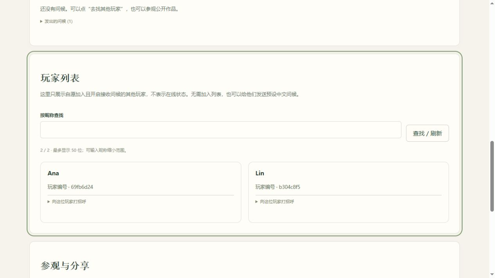

# v0.4.8 玩家发现与问候

## 用户路径

完成新手体验后，进入「更多玩法（可选）→ 参观与分享」，或在布置页的玩家问候面板点击「去找其他玩家」。

- 新增「去找其他玩家」「公开我的作品」按钮。后者跳到现有的保存作品 / 提交审核入口，不直接公开作品。
- 面板明确显示接收已关闭、已加入玩家列表、可从公开作品接收问候、或暂时无法被发现的状态。
- 接收问候与加入玩家列表分开选择。默认不加入，旧用户不会被自动列出。
- 加入方式：开启接收 → 勾选自愿加入 → 填写公开昵称 → 保存设置。无需先发布作品。
- 列表只返回昵称和独立公开编号，不返回浏览器身份、MD5、国家、联系方式或活动时间。列表不是在线状态。
- 可按昵称查询；最多显示 50 位，超过时通过搜索缩小范围。重名使用玩家编号区分。
- 继续使用预设中文问候、回礼和屏蔽，不增加自由文本聊天。作品与列表共用同一接收者每日一次、发送者每日十次的限制。
- 退出列表后旧编号失效；重新加入生成新编号。关闭接收也会退出列表，重新开启不会自动重新加入。屏蔽双方在列表中互不可见，删除身份同时清理相关问候。
- 中、英、越南语、印尼语、巴西葡语均提供界面文案。

## 验证

TDD 分步覆盖独立加入意愿、昵称验证与原子保存、最小公开字段、自身/测试/管理员排除、搜索与数量限制、无公开作品的问候、跨入口限频、屏蔽、退出、重新加入、删除、接口认证及重启持久化、发现状态文案、操作按钮、请求失败和搜索响应乱序。

实际先观察到的失败包括：目录状态缺失、非法设置未拒绝、无作品发送被拒绝、列表接口 404、玩家入口和状态提示缺失、表单未发送独立公开编号、搜索控制器缺失。实现后相关检查通过；本地全量 132 项测试通过。

隔离浏览器使用合成的 Lin、Ana 测试身份，走通新手村、加入列表、按昵称搜索、发送问候、退出列表和进入作品分享入口。390px 视口无横向溢出，浏览器无错误/警告。截图仅为本地合成测试数据。

## 部署

2026-11-08 已上线。独立发布目录 `/home/stu60/releases/han-start-v048-20261108-085321`，服务器 132 项测试通过后切换；当前动态回环端口 33807，服务 active。公网首页与新脚本返回 200；未认证的列表请求为 401，有匿名身份后列表及昵称搜索为 200，新身份默认未接收、未加入。公网验收临时身份已删除，未向真实玩家发送问候。

切换前后数据库逐表哈希一致（访客 7、行为 1827、作品 1，反馈和投稿为 0），完整性检查 ok。真实玩家列表在验收时为 0，没有将合成测试玩家发布到公网。

遵循既有要求，不创建数据库或旧代码备份，不修改已有用户的接收与加入选择。新版本验证后清理上一版独立发布副本和发布包，当前运行数据保留。
